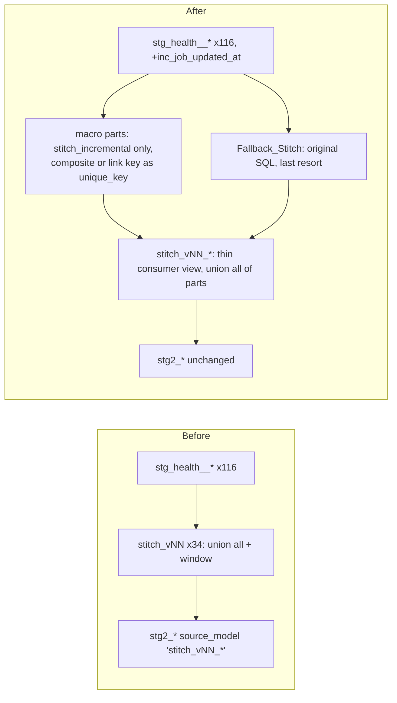

# Design Document

## Overview

This design makes `BGIL_DBT/opus_health_dv_dbt` (the Health_Project) a runnable dbt project that mirrors `BGIL_DBT/opus_partner_dv_dbt` (the Partner_Project), following the Skill `dv2-automatedv-dbt-builder` (`C:\Users\tanma\.kiro\skills\skill.md`, copy at `BGIL_DBT\utils\skill.md`). The scope has three parts: project scaffolding, the reshape of the 34 Health stitched models, and one minimal edit to the `stg_health__*` staging models (add `inc_job_updated_at`). Stage (stg2), hub_feeds and vault models, `build_artifacts/` and `generators/` are not edited. The sibling project `maximus_health_dv_dbt` and every other project are not touched.

All paths are relative to `BGIL_DBT/opus_health_dv_dbt` unless stated.

Facts read from the workspace that drive the design:

- Health has 34 `stitch_vNN_*` views. Each is `merged` (a `union all` over `ref('stg_health__*')` branches, with `__PREC` and `__RID`) followed by a final select that applies `first_value ... ignore nulls over (partition by <hub key> [, <child key>] order by __PREC, __RID ...)` to each payload column. There is no `distinct` or `group by`: the original output has one row per source row that passes the branch filter.
- Stage models read a stitch by the string `source_model: 'stitch_v22_policy'`. Hub and link stage models (for example `stg2_v22_policy`) read the key columns of every row. Satellite stage models (for example `stg2_assessment_underwriting`) read one satellite's prefixed columns plus the key, and derive the key as `case when coalesce(<own payload>) is not null then 'HUB_..|' || <BK> end`. A row without that satellite's payload therefore yields a NULL key and is skipped. They also hard-code `RECORD_SOURCE: '!stitch_v22_policy'` and `LOAD_DATETIME: '!CURRENT_TIMESTAMP()'`.
- Measured over the 34 originals (text analysis, not executed SQL): 127 branches fill two or more key columns in one row (link legs), 493 branch columns carry a literal child key, and 149 branch columns carry a data-driven child key (spread over 19 stitches). The converter's `--plan` mode produces the authoritative per-satellite counts.
- `stitch_incremental` (Partner `macros/stitch_incremental.sql`, copied unchanged) is single-satellite and single-`unique_key`: one `target_sat`, one `unique_key`, one source-system group. Each source gives a `key_column` expression, which the macro selects as `SELECT DISTINCT <key_column> AS <unique_key>` with `WHERE <key_column> IS NOT NULL`. It returns one row per `unique_key`. It filters sources with `ldts_column > from_date AND ldts_column <= to_date` (only keys with at least one row in that window are emitted). It reads sources through `{{ this.database }}.{{ this.schema }}.{{ src.model }}` as a string, not through `ref()`. Because `key_column` is an arbitrary SQL expression, a concatenated key works without any macro change.
- `models/staging/health/` holds 116 `stg_health__*.sql` models plus `_health__sources.yml`. By text search for `as inc_job_updated_at`, 12 select the column (as trimmed varchar) and 104 do not. The requirements use the same count; the script count is authoritative and the Findings_Report states the real number. None of the 104 selects any other `INC_JOB_*` column.

## Architecture



Four work parts:

1. Layout move: `models/automate_dv` to `models/raw_vault` with `git mv`.
2. Scaffolding: `dbt_project.yml`, `profiles.yml`, `packages.yml`, vendored `dbt_packages/`, macros, empty folders, ignore file.
3. Stitched reshape: a one-shot converter generates macro parts and rewrites each `stitch_vNN_*` as a thin consumer view.
4. Staging column edit: a one-shot script adds `inc_job_updated_at` to the stg models that lack it.

Then verification and the Findings_Report.

## Decisions

### D1. Project and profile names (R2.6, R2.7)

The Skill pattern is `name: '<project>_dv_dbt'`, `profile: '<project>_dbt'`. Health uses `name: 'opus_health_dv_dbt'` and `profile: 'opus_health_dbt'`, which is the R2.7 fallback. The key under `models:` is `opus_health_dv_dbt`. The `vars` block keeps `health_raw_database: RAW` and `health_raw_schema: HEALTH` (R2.5). The Skill's `<lob>_test_raw_*` variables are not added because no Health model reads them.

### D2. `dbt_project.yml` (R2.1 to R2.4)

Rewritten from the Skill's canonical block, which equals the Partner file:

- Path keys `model-paths`, `analysis-paths`, `test-paths`, `seed-paths`, `macro-paths`, `snapshot-paths`, `target-path`, `clean-targets` with Partner values. `config-version: 2` is dropped to match Partner.
- `models.opus_health_dv_dbt.staging`: `+materialized: view`, `+schema: BGIL_DATA_MODEL`, `+tags: ["stg1"]`. Health stg1 stays in `models/staging/health/`; a parent key covers its subfolders and the Skill allows a per-LOB subfolder.
- `raw_vault.standard` (`stitched`, `staging`, `hubs`, `links`, `satellites`, `references`) and `raw_vault.augmented` (`staging`, `satellites`) take the folder, materialization, tag and `on_schema_change` map from the Partner file.
- The Partner run-log `+pre-hook` and `+post-hook` are copied.
- Today's per-layer schemas (`stg_health`, `std_automate_dv_health`, `aug_automate_dv_health`) become `BGIL_DATA_MODEL`. This is required: the macro builds `{{ this.database }}.{{ this.schema }}.<stg model>`, so stg1 and every stitched model must share one schema.
- All macro parts live in `raw_vault/standard/stitched/`, so they inherit the `stitched` folder config with no new config keys.

### D3. Packages (R3.5 to R3.7)

- `packages.yml` is a byte copy of the Partner file (`local: dbt_packages/dbt_utils`, `local: dbt_packages/automate_dv`).
- `dbt_packages/dbt_utils` and `dbt_packages/automate_dv` are copied from `opus_partner_dv_dbt` (R3.6). `dbt deps` is not run.
- R3.7 is checked by `dbt parse` resolving the `local:` paths. When dbt is not available, the offline checker confirms each `local:` path exists and its files are byte-equal to Partner's (R3.8, R9.3).
- Copying about 2 MB of package source is a medium-risk bulk addition. It is additive, so it is reversible with `git rm`.
- Tracking (R3.10): Partner tracks `dbt_packages`. The ignore entries in D4 must not match `dbt_packages`; the checker runs `git check-ignore` on sample vendored files.

### D4. Macros, profile and housekeeping (R3.1 to R3.4, R3.9)

- `macros/`: copy all eight Partner macros byte for byte (`generate_schema_name`, `get_run_date`, `hash`, `location_address_key`, `ma_sat_multi_source`, `sat_multi_source`, `stitch_incremental`, `watermark`). R3.1 asks for the macros the Health models or the Stitch_Macro call. Copying all eight keeps the two projects identical. `generate_schema_name` makes `+schema: BGIL_DATA_MODEL` apply verbatim.
- `profiles.yml`: the Skill's two-output template with profile key `opus_health_dbt`; credentials stay `"_"` placeholders as in Partner.
- `analyses/`, `seeds/`, `snapshots/`, `tests/` are created with `.gitkeep`.
- Ignore entries: Partner keeps them in `gitignore.txt`. Health uses a real `.gitignore` with the same entries (`target`, `logs`, and the other Partner entries), appended if a file exists.

### D5. Layout move (R1)

`git mv models/automate_dv models/raw_vault` preserves history (R1.5). `standard/references` is empty in Health and untracked by git, so it is recreated with `.gitkeep` so that the `references` config key resolves (R2.8).

- `README.md` paths are rewritten (R5.2).
- `docs/BUILDER_ASKS_*.md` is scanned and path hits are updated.
- Comments inside moved models that quote `automate_dv/` as a path are not edited, because R6.2 keeps SQL content unchanged. They are listed under the layout category. Package calls such as `automate_dv.stage(...)` are not paths and are not touched.
- `generators/` and `build_artifacts/` still emit and record `models/automate_dv`. They are out of scope; the Findings_Report notes that re-running the generators would recreate the old layout.

### D6. Stitch conversion: macro parts with composite keys behind a thin consumer view (R4, R5.3)

**Problem.** Stage models read `stitch_vNN_*` and expect (a) that exact name, (b) the same prefixed payload columns, and (c) the same key columns (for example `ASSESSMENT_BK`, `POLICY_BK`, `ROLE_TYPE_CODE`). The macro builds one satellite on one `unique_key`. A satellite whose identity is a business key plus a child key, and a link row that carries several keys, therefore need their identity folded into a single key value.

**Decision.** Every satellite and every link is built by the unchanged `stitch_incremental`. Where the identity is more than a single column, `unique_key` is a Surrogate_Key and each source's `key_column` is a Composite_Key_Expression. The key parts come back as payload columns (Key_Part_Columns), so the consumer view can expose the original BK and CK columns. No hand-written part and no separate keys part exist. Each `stitch_vNN_*` name stays as a thin Consumer_View that `union all`s the macro parts. The only exception is the Fallback_Stitch, a last resort.

| Model kind | Name | Built by | Content |
|------------|------|----------|---------|
| Macro part, class A | `stitch_<sat>` | `stitch_incremental`, one call | one satellite, one key |
| Macro part, class B | `stitch_<sat>__<ck_slug>` | `stitch_incremental`, one call | one satellite, one literal child key value |
| Macro part, class C | `stitch_<sat>` | `stitch_incremental`, one call | one satellite, surrogate key over composite key; literal and data-driven branches in the same call |
| Macro part, link legs | `stitch_lk_<link>` | `stitch_incremental`, one call | one link, surrogate link key, one column per leg |
| Macro part, hub only | `stitch_hk_<hub>` | `stitch_incremental`, one call | hub keys of branches that feed no satellite and no link |
| Fallback_Stitch | `stitch_fb_vNN_<topic>` | original SQL, verbatim | last resort only, listed in the Findings_Report |
| Consumer view | `stitch_vNN_<topic>` (original name) | generated plain SQL | `union all` of the parts, original column list |

`<sat>` is the satellite file name without the `sat_` prefix (`SAT_AUG_POLICY_CLASSIFICATION` gives `stitch_aug_policy_classification`). Helper names never start with `stitch_v` plus digits, so only consumer views match the Stitched_Model definition, and no `stitch_vNN_*` file is renamed or removed. No stage model is repointed.

All parts and consumer views sit in `raw_vault/standard/stitched/`. Augmented satellites use the same folder; Health has no `augmented/stitched` config key and the Skill's tag table has none.

#### Satellite classes

The converter parses each original and reads, for every satellite prefix `<SAT>__`, the partition clause of its window functions and the key expressions of its branches.

| Class | Definition | `unique_key` | `key_column` per source |
|-------|------------|--------------|-------------------------|
| A | Partition is exactly one hub key; no child key | hub key column (for example `assessment_bk`) | the original key expression, verbatim |
| B | Partition is one hub key plus a child key, and every branch for the satellite gives the child key as a quoted literal | hub key column, one part per distinct literal (approved Literal_Key_Split) | the original key expression, verbatim; the literal is returned as a payload column |
| C | Any branch gives a data-driven child key, or the partition has two or more non-child keys (composite business key). Literal and data-driven branches of the satellite can both occur | Surrogate_Key `<sat>_pk` (for example `policy_classification_pk`) | Composite_Key_Expression, same normalised format in every branch |
| Link legs | A branch fills two or more key columns in one row | Surrogate_Key `<link>_lk` (the link key) | Link_Key_Expression, legs joined in a fixed order |

Class B stays split by literal because the split is approved and keeps `unique_key` a single business key. The same satellite expressed as class C would also work, so class B is the fallback for volume reasons only (see O3). A satellite is never partly class B and partly class C: a satellite with any data-driven child key branch is class C as a whole, and its literal branches join the same call (R4.11).

#### Composite key format (R4.9, R4.10)

For one satellite the converter builds every `key_column` with one function, so the format is identical in all branches:

```
<bk expr> || '|' || coalesce(<child key expr>, '~')      -- data-driven child key
<bk expr> || '|' || '<literal>'                           -- literal child key, same position, same separator
<bk1> || '|' || <bk2> || '|' || coalesce(<ck>, '~')       -- composite business key with child key
```

Rules:

- Order of parts is fixed per satellite (business key parts in the order of the original partition clause, then the child key).
- Separator is `'|'` everywhere.
- A child key expression that can be NULL is wrapped in `coalesce(..., '~')`. A literal is never NULL and is emitted quoted, unwrapped, which yields the same string as the wrapped form.
- Every non-key part is normalised the same way, with `trim(to_varchar(x))` when the original expression is not already a trimmed stg1 column, so a value from two branches produces one string.
- A business key part that is NULL makes the whole concatenation NULL (Snowflake `||`), so the macro's `WHERE <key_column> IS NOT NULL` drops the row. This equals the original behaviour for a NULL hub key.

The Link_Key_Expression follows the same rules: `<leg1> || '|' || coalesce(<leg2>, '~') || ...`. A leg that is a required key (non-null by the hub semantics) is concatenated plain, so a NULL required leg still drops the row; an optional leg uses `coalesce(..., '~')`. Which legs are optional comes from the original branch (`is not null` filters and the partition clause) and is recorded in the conversion report.

#### Key parts returned as payload columns (R4.9, R4.12)

For each composite or link key the part adds the parts to `columns` and `output_columns`:

```
{'src': 'POLICY_NUMBER',                      'tgt': 'policy_bk'}
{'src': '<child key expr>',                   'tgt': 'aug_policy_classification__classification_type_ck'}   -- raw, not coalesced
```

The child key part uses the raw expression, not the `'~'` form, so a NULL child key comes back as NULL (the macro wraps columns in `NULLIF(TRIM(TO_VARCHAR(x)),'')`). For a literal branch the src is the quoted literal, so a class C part that mixes literal and data-driven branches returns the right CK for both. The consumer view then projects `policy_bk` and the CK column under their original upper-case names, and it does not need to split the surrogate string. The surrogate (`<sat>_pk`, `<link>_lk`) is not part of the original column contract and is not projected.

#### Mapping a branch to the macro config (R4.3 to R4.7)

For satellite S with hub key column `<HUB>_BK`:

- `sources`: one entry per branch that fills S's columns and has a non-null key. Fields: `model` (the `ref()` target name), `alias` (`t0`, `t1`, ... in branch order; the same table with a different key or column expression gets its own alias), `key_column` (class A and B: the original key expression, verbatim; class C and link: the Composite_Key_Expression or Link_Key_Expression), `ldts_column: 'inc_job_updated_at'`, `columns` (`{src, tgt}` per non-null payload column plus the Key_Part_Columns, `tgt` lower case), and `source_tag: 'OPUS_<TABLE>'` with the upper-case table name from the `-- branch N: <TABLE>` comment (R4.7).
- `output_columns`: S's prefixed payload column names in original order, then the Key_Part_Columns, lower case. The macro adds the key and `record_source`.
- `coalesce_rules`: for each output column, the aliases of the sources that fill it, ordered by original `__PREC`, ties by branch number. Key part columns use the same order. A single alias is emitted as a plain column by the macro.
- `target_sat`: the satellite file name in lower case. For a link or hub-only part it is the link or hub name; whether the macro tolerates a target that is not a satellite is checked by the Compile_Check (see O5).
- Class B: the literal is a source column `{'src': "'TRANSACTION_TYPE'", 'tgt': '<sat>__classification_type_ck'}`. The macro interpolates `col.src` as raw SQL, so this produces `NULLIF(TRIM(TO_VARCHAR('TRANSACTION_TYPE')),'')`, which equals the literal. Only branches with that literal enter the part.

#### Macro part shape (R4.2)

```sql
{{ config(materialized='view') }}
-- This part feeds SAT_AUG_POLICY_CLASSIFICATION only. Original precedence comments are in stitch_v22_policy.
-- depends_on: {{ ref('stg_health__bjaz_enroll_scr_dtls') }}

{%- set sources = [
    {
      'model': 'stg_health__bjaz_enroll_scr_dtls',
      'alias': 't0',
      'key_column': "POLICY_NUMBER || '|' || coalesce(TRANSACTION_TYPE, '~')",
      'ldts_column': 'inc_job_updated_at',
      'source_tag': 'OPUS_BJAZ_ENROLL_SCR_DTLS',
      'columns': [
        {'src': 'POLICY_NUMBER',   'tgt': 'policy_bk'},
        {'src': 'TRANSACTION_TYPE','tgt': 'aug_policy_classification__classification_type_ck'},
        {'src': 'CLASS_CODE',      'tgt': 'aug_policy_classification__classification_type_code'}
      ]
    },
    {
      'model': 'stg_health__bjaz_gc_policy',
      'alias': 't1',
      'key_column': "POLICY_NUMBER || '|' || 'GROUP_CLASS'",
      'ldts_column': 'inc_job_updated_at',
      'source_tag': 'OPUS_BJAZ_GC_POLICY',
      'columns': [
        {'src': 'POLICY_NUMBER',   'tgt': 'policy_bk'},
        {'src': "'GROUP_CLASS'",   'tgt': 'aug_policy_classification__classification_type_ck'},
        {'src': 'CLASS_CODE',      'tgt': 'aug_policy_classification__classification_type_code'}
      ]
    }
] -%}



{{ stitch_incremental(
    sources=sources,
    output_columns=output_columns,
    coalesce_rules=coalesce_rules,
    unique_key='policy_classification_pk',
    target_sat='sat_aug_policy_classification'
) }}
```

The sample shows two branches of one satellite in one call: one data-driven (`coalesce(..., '~')`) and one literal, both in the identical `<bk> || '|' || <ck>` format. Table and column names are illustrative. The `depends_on` comments are an addition to the Partner style. The macro reads stg models by string, so dbt would not see the edges and `dbt run --select` would not order stg1 first. The last `set` block closes with plain `%}` and the call ends with `}}`, per the Skill's whitespace pitfall.

#### Consumer view (R4.11, R4.13, R4.19)

```sql
{{ config(materialized='view') }}
-- (original header comments kept verbatim: tables merged, source precedence, satellites fed)
-- Consumer view over parts: stitch_assessment_underwriting, stitch_aug_policy_classification, stitch_lk_policy_role, ...

select
    assessment_bk as ASSESSMENT_BK,
    cast(null as varchar) as POLICY_BK,
    assessment_underwriting__risk_acceptance_authority as ASSESSMENT_UNDERWRITING__RISK_ACCEPTANCE_AUTHORITY,
    cast(null as varchar) as AUG_POLICY_CLASSIFICATION__CLASSIFICATION_TYPE_CK,
    cast(null as varchar) as AUG_POLICY_CLASSIFICATION__CLASSIFICATION_TYPE_CODE,
    ...
from {{ ref('stitch_assessment_underwriting') }}

union all

select
    cast(null as varchar) as ASSESSMENT_BK,
    policy_bk as POLICY_BK,
    cast(null as varchar) as ASSESSMENT_UNDERWRITING__RISK_ACCEPTANCE_AUTHORITY,
    aug_policy_classification__classification_type_ck as AUG_POLICY_CLASSIFICATION__CLASSIFICATION_TYPE_CK,
    aug_policy_classification__classification_type_code as AUG_POLICY_CLASSIFICATION__CLASSIFICATION_TYPE_CODE,
    ...
from {{ ref('stitch_aug_policy_classification') }}
```

Consumer view rules the generator follows:

- The output column list and order equal the original final select (same names, upper case). Every column is varchar (Health stg1 casts everything to trimmed varchar, and null padding is `cast(null as varchar)`).
- **Class A and B:** the hub key column and the payload columns come from the satellite's part; all other columns are padded with NULL. A class B part also supplies its CK column (the literal).
- **Class C:** the BK column(s) and the CK column come from the Key_Part_Columns of the part; the satellite payload comes from the same part; other columns are NULL.
- **Link legs:** every leg column comes from the link part's Key_Part_Columns, on one row, so link stages still see all legs together.
- **Hub only:** the hub key column comes from the hub-only part.
- A key column is supplied by every part that has that key. A payload column is supplied by exactly one part (its `<SAT>__` prefix owner).
- The view contains no windows and no `__PREC` or `__RID`.
- A Fallback_Stitch part, when present, is unioned with the original columns of the satellites it covers.

#### Grain and column-contract implications

| Aspect | Original | New consumer view | Effect on stage models |
|--------|----------|-------------------|------------------------|
| Row grain | one row per source row passing the branch filter, payload replicated across the key partition | one row per (part, surrogate or business key) in the macro window | Satellite stages need only rows carrying their own payload, so they are unaffected. Hub stages see each key at least once, which is all `automate_dv.hub` needs. |
| Payload co-location | all satellites of a hub key on every row of that key | each satellite's payload only on its own part's row; other columns NULL | A stage that reads columns from two satellite prefixes in one expression would see NULLs. The consumer check finds such stages; none is expected. |
| Key columns | any mix on one row | single key per row for class A, B, C and hub-only; all legs of one link on one row from the link part (BK and CK as Key_Part_Columns) | Link stages keep their legs. BK and CK columns stay exposed in every class. |
| Value pick across tables | per column, `first_value ... ignore nulls` over `__PREC`, then `__RID` (can take different columns from different rows of one table) | per key, one row per table chosen by `QUALIFY ROW_NUMBER`, then `COALESCE` across tables in `__PREC` order | **Equal only when each table has at most one row per key** (per business key for class A and B, per surrogate key for class C and link). With several rows per key in one table, per-column first-non-null can combine values from different rows, while the macro keeps the values of one row. The composite key narrows the group (a partition by BK and CK), so class C tables with a child key are more likely to satisfy the condition than the BK-only grouping. |
| Window | all keys, every run | only keys with `from_date < inc_job_updated_at <= to_date` | Intended incremental behavior. A NULL `inc_job_updated_at` never qualifies, so such rows disappear from macro parts. |
| Trim | no extra trim | `NULLIF(TRIM(TO_VARCHAR(x)),'')` | No-op for plain stg1 columns (already trimmed). May change values of computed source expressions. |
| Column names and types | upper-case varchar | identical | None. |

**Consumer check (offline).** The converter writes a consumer map: for every stage model, its `source_model`, the column tokens it uses, whether each exists in the consumer view, and whether the columns it uses from payload prefixes belong to one satellite. Any miss or multi-prefix expression becomes a stitched conversion finding with the stage name (R5.4).

#### NULL child key handling

- Data-driven child key, NULL in a branch: `coalesce(<ck>, '~')` makes the key `<bk>|~`. In the original, a window `partition by bk, ck` places all NULL-ck rows of one BK in one partition; `'~'` reproduces that single partition. Rows of one BK with a NULL ck and rows with a real ck stay in different groups, as before.
- The CK Key_Part_Column returns NULL for these rows (raw expression), so the consumer view shows NULL as before, and not `'~'`.
- Literal child key: never NULL; the string is the same in the surrogate for every branch with that literal.
- A real child key value equal to `'~'`, or any BK/CK containing `'|'`, would collide with another key. The converter scans the stg1 sample distincts when `--raw-columns` or a value profile is supplied, and otherwise records the assumption (see key-format risk).
- A NULL required BK makes the concatenation NULL and the row is dropped, same as the original `is not null` filter.

#### Risks of this approach

- **Key-format consistency.** The merge of two tables works only if their surrogate strings are byte-identical for the same entity. A branch with a different format (missing `coalesce`, different separator, untrimmed value, different part order, literal not quoted the same way) yields a different `unique_key`, so the two rows do not merge and `COALESCE` never runs. The result looks valid and silently splits one entity into two rows. Mitigation: a single render function builds every `key_column` for a satellite (Property 5), the checker compares the normalised template of all branches of one satellite, and the equivalence check (O5) counts rows per BK.
- **Delimiter and sentinel collision.** `'|'` inside a value, or a real `'~'` child key, can join two different keys or split an entity. Mitigation: the profile check above; if collisions exist, the converter switches that satellite's separator to a character absent from the data, for all branches at once, and records it.
- **Row-for-row equivalence is not claimed.** Equivalence is claimed on what stages consume: per satellite and key, the same payload tuple (given at most one row per key per table) and the same key tuples for links. Property 10 tests this against a reference model; the Skill's "0 rows differ" post-run queries must still run on Snowflake (not run here).
- **NULL watermark data loss.** The macro filters on `inc_job_updated_at`. Rows with NULL there never enter a part. Source tables with partly NULL values lose keys relative to the original. Mitigation: a post-run null-count query per source table in the Findings_Report.
- **Mixed watermark types.** The 12 existing stg models keep varchar `inc_job_updated_at` (R7.2 forbids change) while the 104 edited ones are `timestamp_ntz`. The macro runs `GREATEST_IGNORE_NULLS` across sources and compares with `CAST(... AS TIMESTAMP_NTZ)`. The macro cannot take an expression for `ldts_column` (it is used as `alias.<name>` and as a bare select item), and it must stay identical (R3.2). The converter lists every part that reads one of the 12 as a staging column finding with the recommendation to cast those 12 in a follow-up.
- **Watermark never narrows.** The macro reads `MAX(DBT_RUN_TS)` where `RECORD_SOURCE LIKE 'OPUS_%'`. Stage models store `stitch_vNN_*` (a hard-coded literal), so no rows match, `from_date` falls back to `1900-01-01`, and every run reloads everything. This is safe for correctness and costs performance. It is an out-of-scope stage mismatch (Skill defect class #12) and is recorded, not fixed. Do not drop `target_sat` to avoid it: without it the macro uses a T-1 window and would drop older changes.
- **Object count and scan cost.** Parts add models (one per class A and C satellite, one per class B literal, one per link, plus hub-only parts). A source table used by several parts is scanned once per part instead of once per original stitch. `--plan` prints the counts before any write.
- **Macro behavior differences** versus originals are recorded under the stitched conversion category: single-row choice per table, NULLs ordered last, trim.

#### Fallback_Stitch (R4.14, R4.15, R4.20)

If no consistent Composite_Key_Expression can be produced for a satellite (for example the child key depends on a window or aggregate, branches need different grains, or a value profile shows unavoidable delimiter collisions), the converter:

1. records a finding with file name, branch number and construct in the conversion report (R4.14);
2. only then keeps the original SQL for that satellite as a Fallback_Stitch: `stitch_fb_vNN_<topic>` holding the verbatim original (no pruning, no edits), unioned into the consumer view for that satellite's columns only, or, when every satellite of the stitch falls back, the original `stitch_vNN_*` file kept as it is;
3. lists it in the Findings_Report as a last resort (R4.15, R4.20).

A Fallback_Stitch is the only model besides consumer views allowed to contain `union all`, `__PREC`, `__RID` and `first_value`. The expected count is zero; `--plan` prints the number.

#### Converter script

`scripts/convert_stitches.py` (new folder at the project root, outside `model-paths`):

1. Parses each original (`-- branch N: TABLE`, key expressions, column aliases, `__PREC`, satellite prefixes, final-select partition clauses).
2. Classifies satellites into A, B, C and finds link-leg branches and hub-only branches.
3. Renders macro parts (`render_key_column`, `render_part`), consumer views (`render_view`) and, when needed, Fallback_Stitches, or in `--plan` prints counts only.
4. Writes `conversion_report.json`: multi-satellite entries, the class of each satellite, each literal split (original, parts, literal), the key template per satellite, optional legs per link, the Fallback_Stitch list with file/branch/construct, the consumer map, the watermark precheck table, and the mixed-type part list.

`generators/` is neither edited nor imported. The script is kept as evidence and can be deleted after review. It never overwrites an existing output unless `--force` is passed.

### D7. `stitch_incremental` contract points

Read from the macro source, not executed.

`source_tag`: must contain an underscore; the text before the first underscore is the source-system group and every source in one part must share it, else `mixed source-system prefixes`. Health uses `OPUS_<TABLE>`, so the group is `OPUS`. `record_source` in the output is the comma-joined tags of matching sources.

`ldts_column`: every source needs one, and the macro also outputs `inc_job_updated_at` as `GREATEST_IGNORE_NULLS` over all sources' `ldts_column`. The Skill makes `inc_job_updated_at` mandatory in every stg model with no fallback, so every source entry uses `ldts_column: 'inc_job_updated_at'`. This is why D8 is a precondition of the stitched models running. `dbt parse` and `dbt compile` do not check column names, so a missing column would only fail at `dbt run` with an invalid identifier.

`key_column` and `unique_key`: `key_column` is interpolated as raw SQL and aliased to `unique_key`, so a concatenation is valid and the macro stays unchanged (R4.13). The macro does not trim or cast `key_column`, which is why the converter builds the normalised string itself. Key parts leave through `columns`, which the macro does wrap with `NULLIF(TRIM(TO_VARCHAR(x)),'')`.

### D8. Staging column: add `inc_job_updated_at` (R7)

**Source expression.** The Skill's stg1 rules and the Partner stg1 models give two forms. Counting the 43 Partner models: 26 use `"INC_JOB_UPDATED_AT"::timestamp_ntz as inc_job_updated_at` and 17 use `to_timestamp_ntz(regexp_replace("INC_JOB_UPDATED_AT"::varchar, '^Z[ ]*', '')) as inc_job_updated_at`. The second form appears in tables whose other date columns also carry a `Z `-prefixed text format. The Health stg models give no sign of that format (everything is trimmed varchar, no datatype catalogue). So the script uses the plain form by default:

```sql
"INC_JOB_UPDATED_AT"::timestamp_ntz as inc_job_updated_at,
```

An option `--z-prefix-tables a,b` switches named tables to the regexp form, for cases found later. Risk: if raw values carry a `Z ` prefix, `::timestamp_ntz` fails at run time for that table. Recorded as a staging column finding.

**Where the raw column comes from.** The Skill states that every source table carries the column. In Health, none of the 104 models selects any `INC_JOB_*` column, and `build_artifacts` lists `INC_JOB_UPDATED_AT` only for the 12 that have it. That points to a gap in the pinned catalogue for the other tables, but it is not proof that the raw tables have the column. The workspace has no raw column listing. Decision:

- Default: trust the Skill and add the column to all models that lack it, marking each as `unverified against RAW`.
- Evidence option: `--raw-columns <csv>` (columns `TABLE_NAME,COLUMN_NAME[,DATA_TYPE]`, exported with `select table_name, column_name, data_type from RAW.INFORMATION_SCHEMA.COLUMNS where table_schema = 'HEALTH'`). When given, any model whose table lacks `INC_JOB_UPDATED_AT` is left unchanged and recorded as "no usable raw column" (R7.5). The plan gate asks the user to supply this export before `--write`; if they cannot, the default applies and the report says so.
- Also left unchanged and recorded (R7.5): a model whose select list cannot be parsed safely (see algorithm).

**Edit algorithm (pure function on file bytes, so it is testable).**

1. Strip `--` comments and check for `\bas\s+inc_job_updated_at\b` (case-insensitive). If found, status `already`, no change.
2. Require exactly one line matching `from {{ source(` and, before it, a line that is only `select`. Between them every line must be a single-line item `<expr> as <alias>[,]`. If not, status `skipped: unparsable`.
3. For each item, take the first quoted identifier in `<expr>` (for example `"LOAN_ACC_NUMBER"`) as its raw column. The anchor is the first item whose raw column sorts after `INC_JOB_UPDATED_AT`; if there is none, the anchor is the last item.
4. Insert one new line directly before the anchor line, with the anchor's indentation, the template above (with a trailing comma), and the file's newline style (LF or CRLF, detected from the file).

Every item before and after the anchor keeps its own text, including the last item's missing comma. The result is a pure one-line insertion: deleting that line restores the original bytes. Position is alphabetical like the existing Health models (the 12 are sorted), not last like Partner; downstream consumers select by column name, so position does not matter.

**Script.** `scripts/add_inc_job_updated_at.py` with `--plan` (default, writes nothing), `--write`, `--raw-columns`, `--z-prefix-tables`, `--report <path>`. It reads and writes bytes, so BOM and newline style are preserved. The report lists `changed`, `already`, `skipped` (with reason) and `unverified` models, and the three counts for R7.7. The converter's watermark precheck reads the final state of the stg files.

**Count note.** At design time the counts are 12 already, 104 to change, 0 known skips. The script output replaces these numbers.

### D9. Verification strategy (R9)

Stage models still resolve because every stitch name stays, so `dbt parse` is expected to be clean for the whole project, not only the scaffolding. Three tiers:

1. Offline checker `scripts/check_health_project.py` (always runs): YAML validity of `dbt_project.yml`, `profiles.yml`, `packages.yml`; profile name present; configured folders exist; macro and vendored package byte equality with Partner (including `stitch_incremental.sql`, R3.2, R4.13); `.gitignore` entries; `git check-ignore` on vendored samples; every macro part has exactly one `stitch_incremental(` call with `sources`, `output_columns`, `coalesce_rules`, `unique_key` and `target_sat` and balanced Jinja; the key-format check (every `key_column` of one satellite normalises to one template); every Key_Part_Column named in a consumer view exists in `output_columns` of its part; no legacy tokens outside allowed roles; `source_tag` regex; every consumer view has the original column list; every `ref()` and every stage `source_model` resolves; hashes of out-of-scope files unchanged; the count of stg models containing `inc_job_updated_at` (R8.5); a watermark precheck table.
2. `dbt parse` and `dbt compile --select tag:stitch tag:stg1` when dbt and credentials exist. Compile of macro parts runs `adapter.get_relation` and `run_query` unless `--vars '{from_date: ...}'` is passed. Whether parse opens a warehouse connection with the placeholder profile was not verified here. Blocked checks are recorded (R9.3).
3. Equivalence queries against the original stitches (post-run, manual): per satellite, rows differing in `(key, payload tuple)`, the key tuples for links, and for composite keys the row count per business key against the original (see O5).

## Components and Interfaces

| Component | Responsibility | Interface |
|-----------|----------------|-----------|
| `dbt_project.yml`, `profiles.yml`, `packages.yml`, `.gitignore` | Project config | YAML / text |
| `dbt_packages/`, `macros/*` | Vendored packages and Partner macros | byte copies |
| `scripts/convert_stitches.py` | Parse originals, classify, render composite keys, macro parts and consumer views, Fallback_Stitch, report | CLI: `--plan`, `--write`, `--force`, `--report` |
| `scripts/add_inc_job_updated_at.py` | One-line insertion into stg models | CLI: `--plan`, `--write`, `--raw-columns`, `--z-prefix-tables`, `--report` |
| `scripts/check_health_project.py` | Offline checker (tier 1) | CLI, non-zero exit on failure |
| Findings_Report `.kiro/specs/opus-health-dv-dbt-runnable/findings.md` | Five categories: layout, configuration, stitched conversion, staging column, out-of-scope compile mismatch | Markdown |

## Data Models

```python
@dataclass
class KeyPart:
    expr: str                  # SQL expression of the part (raw, not coalesced)
    tgt: str                   # Key_Part_Column name, lower case (policy_bk, ..._ck)
    nullable: bool             # True -> wrapped in coalesce(expr, '~') inside the key
    literal: str | None        # set for a literal child key

@dataclass
class KeySpec:
    unique_key: str            # 'policy_classification_pk', 'policy_role_lk' or the hub key column
    parts: list[KeyPart]       # fixed order; len == 1 for class A and B
    separator: str             # '|' unless a collision forces another character
    # key_column = render_key_column(parts, separator)

@dataclass
class Branch:
    index: int                 # "-- branch N"
    table: str                 # BJAZ_ENROLL_SCR_DTLS
    model: str                 # stg_health__bjaz_enroll_scr_dtls
    keys: dict[str, str]       # non-null key column -> expression (e.g. POLICY_BK)
    where: str                 # original filter, verbatim
    prec: int                  # __PREC literal
    columns: dict[str, str]    # payload column -> source expression (non-null only)
    ck_literal: str | None     # child key literal, or None
    ck_data_driven: bool

@dataclass
class SatSpec:
    sat: str                   # SAT_POLICY_CLASSIFICATION
    klass: str                 # 'A' | 'B' | 'C' | 'LINK' | 'HUB'
    key: KeySpec
    payload: list[str]
    branches: list[Branch]

@dataclass
class Finding:
    file: str
    branch: int | None
    construct: str
    fallback: bool             # True -> kept as Fallback_Stitch

@dataclass
class StgEdit:
    model: str
    status: str                # 'changed' | 'already' | 'skipped'
    reason: str | None         # 'unparsable' | 'no raw column' | None
    verified: bool             # raw column confirmed by --raw-columns
```

Pure functions under test: `parse(text) -> list[SatSpec]`, `classify`, `render_key_column(parts, sep)`, `render_part(spec)`, `render_view(stitch, parts)`, `fallback_stitch(text, finding)`, and `edit_stg(text, evidence) -> (text', StgEdit)`. The functions `prune` and `render_keys` of the earlier design no longer exist.

## Error Handling

- Converter: an original that does not match the expected shape aborts that stitch with a report entry. No partial output is written for it, the run continues with other stitches, and the exit code is non-zero.
- A satellite for which no consistent Composite_Key_Expression can be produced is not silently converted: it gets a finding (file, branch, construct) and then a Fallback_Stitch, and the exit code stays zero only if the finding was recorded.
- A branch whose key format differs from the satellite template is a converter error, not a finding, because the renderer builds all branches from one function.
- Staging script: any model it cannot parse safely is returned byte-identical with status `skipped`. It never raises on a single file.
- Macro compile errors (malformed or mixed `source_tag`) are prevented by construction (`OPUS_<TABLE>`) and covered by the checker.
- A missing `inc_job_updated_at` is detected by the checker precheck (stg model by name) and reported.
- Parse and compile errors are classified as scaffolding, stitched or staging (must be zero) versus out-of-scope (recorded with model name, message and suggested cause, R6.4).
- Blocked `dbt` checks are recorded with the reason, and tier 1 results stand in (R9.3).
- Both scripts default to plan mode and never overwrite existing output without a flag.

## Testing Strategy

Property-based tests use Hypothesis (Python), at least 100 iterations each, tagged `Feature: opus-health-dv-dbt-runnable, Property N: <text>`. They target the pure functions above and the checker. Generators produce synthetic original stitches (branch counts, tables, key shapes including composite business keys, link legs with optional legs, precedence values, literal and data-driven child keys mixed in one satellite, NULL child keys) and synthetic stg model texts (LF and CRLF, varying indentation, alias presence, odd shapes).

Unit and example tests cover layout and config checks (R1, R2, R3), byte equality of macros, packages and `packages.yml`, README paths, the five report headings, and the blocked-check path. `dbt parse` and `dbt compile` run once as integration checks, not as property tests.

The reference model for Property 10 is a small Python evaluator of (a) the original window semantics and (b) the macro's documented semantics (distinct key per table, one row per table, coalesce in rule order), with the composite key evaluated as a string. It does not run SQL.

## Open Decisions for Review

- **O1. Raw column evidence for the 104 stg models.** Supply the `INFORMATION_SCHEMA` export before the staging edit, or accept the Skill default (add to all, mark unverified). Recommended: supply it.
- **O3. Class B volume.** If `--plan` shows too many literal parts, merge class B satellites into class C (one composite-key call per satellite), which needs fewer models and uses the same literal-and-data-driven mix already supported.
- **O5. Equivalence check for composite keys.** Confirm how the post-run equivalence is judged: per satellite and key, compare `(bk, ck, payload tuple)` between original and consumer view, and compare distinct-surrogate counts with distinct `(bk, ck)` counts of the original. Also confirm the accepted differences (one row per table per key, NULL watermark rows, `'~'` and `'|'` collisions) and whether a link or hub-only part may use a non-satellite `target_sat`. The assumption in this design is that a clean Compile_Check plus these queries on Snowflake is the acceptance test.

## Correctness Properties

*A property is a characteristic or behavior that should hold true across all valid executions of a system-essentially, a formal statement about what the system should do. Properties serve as the bridge between human-readable specifications and machine-verifiable correctness guarantees.*

Reflection on redundancy: the satellite coverage criteria (4.6, 4.11, 4.16) merge into one coverage property. The report criteria (4.8, 4.14, 4.15, 4.16, 4.20, 5.4) merge into one findings property. The unchanged-file criteria (3.2, 4.13, 5.5, 6.1, 6.2) are one hash property. The staging criteria split into three: minimal diff and template (7.1, 7.3, 7.4, 6.3), idempotence and no-op (7.2, 7.6), and skip safety plus counts (7.5, 7.7). The composite key format (4.10) and the key-part round trip (4.9, 4.12) test different things (consistency across branches versus recoverability of the parts) and stay separate. The macro part properties (structure, sources, outputs, coalesce, tags) check different fields and stay separate. The layout, folder-report and reference properties stay separate because they test different pure functions.

### Property 1: Layout move preserves every model

For any set of model file paths under `models/automate_dv` in the pre-move manifest, replacing the prefix with `models/raw_vault` gives a path set of the same size (the mapping is injective), every mapped path exists after the move, and no path under `models/automate_dv` exists.

**Validates: Requirements 1.2, 1.3**

### Property 2: Macro parts have the required structure

For any generated macro part, the text contains exactly one `config(materialized='view')`, one `sources` list, one `output_columns` list, one `coalesce_rules` map, and exactly one `stitch_incremental(` call whose arguments are `sources`, `output_columns`, `coalesce_rules`, `unique_key` and `target_sat`.

**Validates: Requirements 4.2**

### Property 3: Every satellite and link is covered exactly once

For any original stitch, the set of `target_sat` values over its macro parts and Fallback_Stitches equals the set of satellites and links it feeds, no part targets a satellite the original does not list, each class A, class C and link has exactly one part, each class B satellite has exactly one part per distinct child key literal found in the original, and a satellite that mixes literal and data-driven child key branches is built in one call. Every consumer view keeps the original file name.

**Validates: Requirements 4.1, 4.6, 4.11, 4.16, 4.17**

### Property 4: Sources reproduce the original branches

For any satellite and its macro part, parsing the part's `sources` back yields, for each contributing branch, the same `ref` model and the same `{src, tgt}` payload column pairs as the original branch, plus the Key_Part_Columns; the `key_column` of a class A or B source equals the original key expression; and class B parts contain only branches with their literal.

**Validates: Requirements 4.3**

### Property 5: Composite keys use one normalised format in every branch

For any satellite that uses a Composite_Key_Expression, and for any mix of literal and data-driven child key branches, every `key_column` in its part has the same part order and separator, every nullable child key part is wrapped in `coalesce(<expr>, '~')`, a literal part is quoted and unwrapped, and replacing the branch-specific expressions with placeholders gives one identical template for all branches. The same holds for the Link_Key_Expression of any link.

**Validates: Requirements 4.9, 4.10, 4.11, 4.12**

### Property 6: Key parts survive the composite key

For any business key value, any child key value that is either NULL or a string without the separator and different from `'~'`, evaluating the composite key with the reference evaluator gives a string whose split on the separator equals the business key and the child key (with `'~'` standing for NULL), and evaluating the Key_Part_Columns returns the business key and the child key (NULL for NULL). For any link, every leg is recoverable in the same way from the Link_Key_Expression and its leg columns.

**Validates: Requirements 4.9, 4.12**

### Property 7: Output columns equal the satellite payload plus key parts

For any macro part, `output_columns` equals the payload columns the original branches fill for that satellite (for class B parts, including the child key column), followed by the Key_Part_Columns of its key, with no extras or omissions, the keys of `coalesce_rules` equal `output_columns`, and `unique_key` is not among the output columns.

**Validates: Requirements 4.4, 4.9**

### Property 8: Coalesce order follows source precedence

For any satellite and any output column, the aliases in `coalesce_rules[column]` are ordered by nondecreasing original `__PREC` of their branches, with ties ordered by branch number, and contain only aliases whose branch fills that column.

**Validates: Requirements 4.5**

### Property 9: Source tags follow the system-prefix form

For any generated source entry, `source_tag` equals `OPUS_` followed by the upper-case table name from the original branch comment, matches `^OPUS_[A-Z0-9_]+$`, and all tags in one part share the prefix `OPUS`.

**Validates: Requirements 4.7**

### Property 10: Consumer views keep the column contract and the consumed semantics

For any original stitch, its consumer view (a) keeps the original file name, (b) has the same output column names and order as the original final select, (c) takes each payload column from exactly one owner part, and (d) takes the BK and CK columns of every class and all legs of every link from the Key_Part_Columns of the owning part. For any synthetic dataset with at most one row per key per source table (key = business key for class A and B, surrogate key for class C and link), evaluating the parts with the reference model gives, for every satellite and every key, the same payload tuple as the original window semantics, and the same BK and CK values and the same leg tuples for links.

**Validates: Requirements 4.1, 4.9, 4.11, 4.12, 5.3**

### Property 11: Grain difference is confined to multi-row keys

For any synthetic dataset and any satellite, if the reference model's macro result and the original window result differ for a key, then some source table has more than one row for that key (business key for class A and B, composite key for class C and link).

**Validates: Requirements 4.3, 4.9**

### Property 12: Fallback_Stitch is a verbatim last resort

For any original stitch, a Fallback_Stitch exists for a satellite if and only if the converter recorded a finding (file name, branch number, construct) for that satellite, the Fallback_Stitch text equals the original SQL for that satellite without edits, and the Findings_Report lists it as a last resort. For any satellite with no finding, no Fallback_Stitch exists.

**Validates: Requirements 4.14, 4.15, 4.20**

### Property 13: Legacy merge tokens appear only where allowed

For any generated file, macro parts contain none of `union all`, `__PREC`, `__RID`, `first_value`; consumer views may contain `union all` but none of `__PREC`, `__RID`, `first_value`; only Fallback_Stitches may contain all four. For any consumer view, every comment line of the original header (source precedence and satellites fed) appears in it.

**Validates: Requirements 4.18, 4.19**

### Property 14: Findings are complete

For any original stitch, the conversion report has a multi-satellite entry if and only if the stitch feeds more than one satellite, lists each literal split with the original name, the part names and each literal, and has one entry (file name, branch number, construct) for every branch for which no consistent composite key could be produced. For any stage model that uses a column the consumer view lacks, the report names the stage model, the column and the view.

**Validates: Requirements 4.8, 4.14, 4.16, 4.20, 5.4**

### Property 15: Unchanged files stay byte-identical

For any file in `generators/`, `build_artifacts/`, or an out-of-scope layer model (stage, hub_feeds, hubs, links, satellites, references), and for `macros/stitch_incremental.sql` against the Partner copy, the content hash after the feature equals the hash before it (or the Partner hash for the macro), compared at the new path for moved files.

**Validates: Requirements 3.2, 4.13, 5.3, 5.5, 6.1, 6.2**

### Property 16: References resolve

For any `ref()` target in a generated model or scaffolding file, and for any `source_model` string in a stage model, a model file with that name exists under `models/`.

**Validates: Requirements 5.1, 5.3**

### Property 17: Staging edit is a minimal one-line insertion

For any staging model text without the column and with a parseable select list, the edited text equals the original with exactly one line inserted, deleting that line returns the original bytes (LF or CRLF), the line equals the template with the anchor's indentation, and no other line changed, including the last select item.

**Validates: Requirements 6.3, 7.1, 7.3, 7.4**

### Property 18: Staging edit is idempotent and respects existing columns

For any staging model text, applying the edit twice gives the same bytes as applying it once; for any text that already aliases `inc_job_updated_at` outside comments, the edit returns the same bytes with status `already`; and after the edit every model not recorded as skipped matches the alias pattern.

**Validates: Requirements 7.2, 7.6**

### Property 19: Unusable models are untouched and counts add up

For any set of staging models and raw column evidence, every model with an unparseable select list or with evidence that its table lacks the column is returned byte-identical and appears in the report with a reason, and `changed + already + skipped` equals the number of models.

**Validates: Requirements 7.5, 7.7**

### Property 20: Missing configured folders are recorded

For any set of folders named in `dbt_project.yml` model configuration and any subset that does not exist under `models`, the checker reports exactly that subset.

**Validates: Requirements 2.8**
